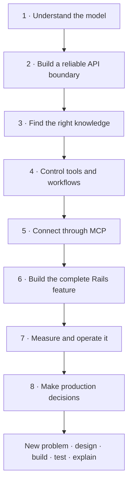

# AI Learnings · build AI features you can explain

You already build software. This course adds a new kind of dependency: a model whose output can be useful and still be wrong.

Start here. You do not need to remember ML equations. Learn one mechanism, follow one input, break one assumption, then explain the repair without notes.

## Your map

The whole course is about 115 hours including practice, or roughly 17 weeks at 7 hours/week. This is an estimate, not a deadline promise. Start with a four-week foundation sprint. Continue through the full course afterward. A month at this pace does not cover the full course in depth.

## The first four weeks · 7 hours each

- **Week 1 — What a model knows.** Study chapters 1–4 in Understand the model. Draw tokens → context → generation. Explain training versus a request. Spend the remaining hour on recall and a tiny repair.
- **Week 2 — Where it can be wrong.** Finish that stage. Try two different task constraints. Compare model choices using task evidence. Use the last two hours for practice and recall.
- **Week 3 — Make an API contract.** Work through prompts, structured results, provider adapters, and the tool cycle. Sketch the data that crosses each boundary. Do not confuse a valid shape with a true result.
- **Week 4 — Make failure ordinary.** Study timeouts, streams, and traces. Run the Dispatch Desk lab using fixtures. Test an unknown filter and an invalid citation. Explain the fallback path. Use the last session for a closed-notes design review.

This sprint deliberately revisits ideas. If practice takes longer, reduce new chapters. Keep the weekly time; move the chapter deadline. At its end, aim to explain and test a narrow read-only AI boundary. Full retrieval, MCP security, and production operation come later.

## One chapter · a repeatable session

1. **Recall, 5 minutes.** Say yesterday’s rule and one failure without opening the lesson.
2. **Learn, 15–20 minutes.** Read one short step. Follow its diagram. Stop at a new term and use the glossary below.
3. **Predict, 10 minutes.** Follow a concrete input. Change a slider when available. Write the expected result first.
4. **Do, 25–40 minutes.** Try the repair or changed requirement. Record Predict, Change, Verify, Explain. State “not run” when you only designed it.
5. **Compare, 10 minutes.** Submit the snapshot, then open the separate reference. Find one gap. AI feedback is a second opinion and does not execute your code.
6. **Return later.** Use Spaced recall before rereading. Rebuild a small diagram and solve a changed case.

A chapter may take several sessions. Use two 90-minute blocks for new material, one two-hour lab block, and two one-hour recall/practice blocks each week. Seven hours total. Read less when the lab needs more time.

## How the app works

Choose **AI Learnings** in the top navigation, then start at Stage 1. Stages are a sequence; levels describe the chapter’s depth. Finish the stage before skipping to a later one. Use Next to move forward.

- **Learn** shows four small steps and a diagram. “Mark read” records reading only.
- **Predict** walks a mechanism. Some chapters include a deterministic interactive sandbox. These do not call a model.
- **Code lab** shows complete files and commands. Run those commands in the separate journal training folder. The browser does not execute Rails, Docker, or your submission.
- **Practice** saves your four-part attempt. The reference answer unlocks after a submission for that exercise. A saved snapshot is kept when you start a fresh draft.
- **Ask AI to review** sends that snapshot and the course reference to the configured app teacher. It scores four areas from 0–3. It can be wrong. It cannot verify a command was run.
- **Ask AI a question** uses the selected lesson or lab file. In practice mode, the teacher receives the prompt rather than the reference. This is a teaching guard, not secret storage: the downloadable course contains answers.
- **Quiz** holds explanations until every question is answered. Stage endings include earlier ideas. The final quiz mixes stages.
- **Spaced recall** asks for an explanation before showing the answer. Again returns in 10 minutes; Hard in one day; Good uses increasing gaps. Missing a day is fine: do due cards before adding more.
- **Backup** exports AI progress separately. Existing Software, DSA, and HLD progress use their own storage. Browser storage is local, so export regularly.

The four chapter checks are read, both practice attempts, latest quiz at least 75%, and a good conceptual recall at least seven days after practice. They are evidence of activity and recall, not an expert certificate. Revisit an unaided transfer problem even after a green check.

## Completion gates · show what you can do

**Gate 1 — Model and API foundation, stages 1–2.** From a blank page, explain context, training/inference, uncertainty, structured output, a tool loop, and a timeout. Design an adapter with refusal, invalid output, and fallback states. Pass the cumulative checks and explain why each rejected option fails.

**Gate 2 — Knowledge and controlled tools, stages 3–5.** Choose SQL, document retrieval, or both for a new task. Trace ingestion to a cited answer. Test a foreign-tenant candidate, missing evidence, a disallowed tool, and an expired approval. Explain host/client/server, initialization, transport, and application authorization separately. Run the scoped MCP tool locally.

**Gate 3 — Useful application, stages 6–7.** Trace filter, explanation, comparison, and briefing across Rails files. Re-run the offline fault matrix. Add one new deterministic rule and its regression check. Create a labelled evaluation set with normal, ambiguous, adversarial, unavailable, and stale cases. Set acceptance and rollback criteria before comparing models.

**Gate 4 — Production design, stage 8.** Solve a new domain problem without copying Dispatch Desk. Justify the simplest design. Decide whether retrieval, a workflow, an agent, tuning, or self-hosting earns its cost. Explain replay, approvals, privacy, budgets, deployment and rollback. Present evidence, unknowns, and one alternative. Complete the final capstone and repeat a changed problem at least a week later.

For every gate keep: a diagram, one recorded explanation, a test report or honest “design only” note, and a list of remaining risks. The lab automates contracts, not live-model quality. A production gate still needs environment-specific authorization, durable infrastructure, real evaluation, and a reviewed release.

## The general design framework · use it on any AI feature

**Task → Truth → Boundary → Flow → Failure → Measure.**

- **Task:** Who needs what outcome? What should remain manual?
- **Truth:** Which system owns each fact? What may be stale? What evidence is missing?
- **Boundary:** Who is allowed to read or act? Which inputs and outputs are accepted?
- **Flow:** Which deterministic steps run? Where does the model propose something? Is an agent needed?
- **Failure:** Timeout, refusal, bad output, stale data, prompt injection, duplicate work, or a revoked user: what happens next?
- **Measure:** What cases, metrics, budgets, traces, and rollback rule show this is useful?

Example: “Explain why this parcel is held.” Task = help an operator. Truth = current shipment fields and reviewed rules. Boundary = that operator’s permitted shipments. Flow = facts → optional draft → checks → labelled answer. Failure = reviewed rule guidance. Measure = correct reasons, unsupported claims, access leaks, latency, and cost.

## Small glossary · read only the term you need

- **Token:** a piece of model input/output. It may be part of a word.
- **Context:** the material supplied for this request. It has a finite budget.
- **Weights:** learned numeric parameters. A prompt does not normally update them.
- **Inference:** using a trained model to produce output.
- **Embedding:** a numeric representation used for similarity. Similarity is not permission or truth.
- **RAG:** retrieve outside evidence, then generate using it. Retrieval can use more than vectors.
- **Grounding:** connect an answer to supplied evidence. A citation alone does not prove support.
- **Schema:** allowed output structure. It does not establish business correctness.
- **Tool:** a named operation the application can choose to expose. Code decides whether it runs.
- **Agent:** a loop where model output helps choose a next step. Give it a stopping rule and budget.
- **Workflow:** code chooses the steps, with optional model calls inside them.
- **MCP:** a protocol for connecting AI hosts to tools and context. It does not replace your permissions.
- **Idempotency:** retries of the same intended operation do not repeat its effect.
- **Evaluation:** compare behavior against defined cases and acceptance criteria.
- **Calibration:** how observed correctness relates to scores. A confident sentence is not a calibrated probability.
- **Prompt injection:** untrusted content tries to change the task or obtain extra authority.
- **Provenance:** where evidence came from, including its version and time.
- **Entailment:** whether the evidence actually supports the claim.

## Why this learning loop

Retrieval practice and practice spaced over time have strong support in learning research. This course applies them with closed-notes explanations, delayed cards, and changed problems. The exact chapter timing and app intervals are design choices, not a scientifically optimal schedule for every learner. No course can guarantee permanent retention. Your test is being able to reconstruct the idea and solve a new case later.

Read [Roediger and Karpicke’s retrieval study](https://journals.sagepub.com/doi/10.1111/j.1467-9280.2006.01693.x) and [Dunlosky and colleagues’ review](https://pubmed.ncbi.nlm.nih.gov/26173288/) if you want the evidence. Use the course before adding more resources.
