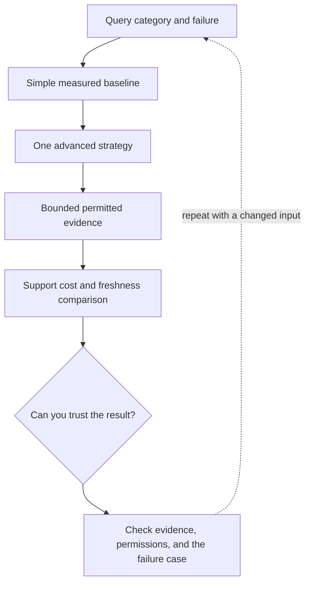

# 1. Advanced retrieval: hierarchy, graphs, and query planning

**Advanced · about 2.5 hours including practice**

Choose advanced retrieval from a query failure pattern rather than a trend.

Read idea → example → trace → failure. Then attempt practice/repair.md and practice/transfer.md.

Answers are separate in answers/. The app also provides prediction, quiz, recall, and optional AI review.

- [GraphRAG research](https://arxiv.org/abs/2404.16130)
- [PageIndex implementation](https://github.com/VectifyAI/PageIndex)
- [Your AI journal](https://github.com/Chaitanya31612/ai-mastery-journal)
