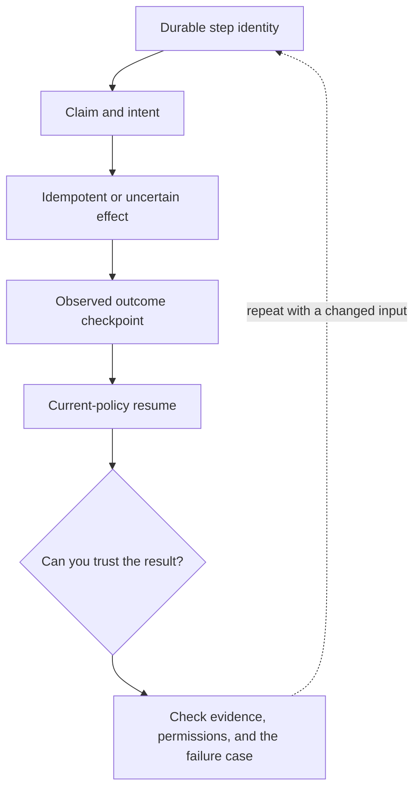

# 2. Durable agents: resume without repeating effects

**Advanced · about 2.5 hours including practice**

Design run checkpoints, claims, leases, approval freshness, and uncertain-effect recovery.

Read idea → example → trace → failure. Then attempt practice/repair.md and practice/transfer.md. Answers are separate in answers/. The app also provides prediction, quiz, recall, and optional AI review.

- [Composable agent patterns](https://www.anthropic.com/research/building-effective-agents)
- [MCP security boundaries](https://modelcontextprotocol.io/docs/2025-11-25/tutorials/security/security_best_practices)
