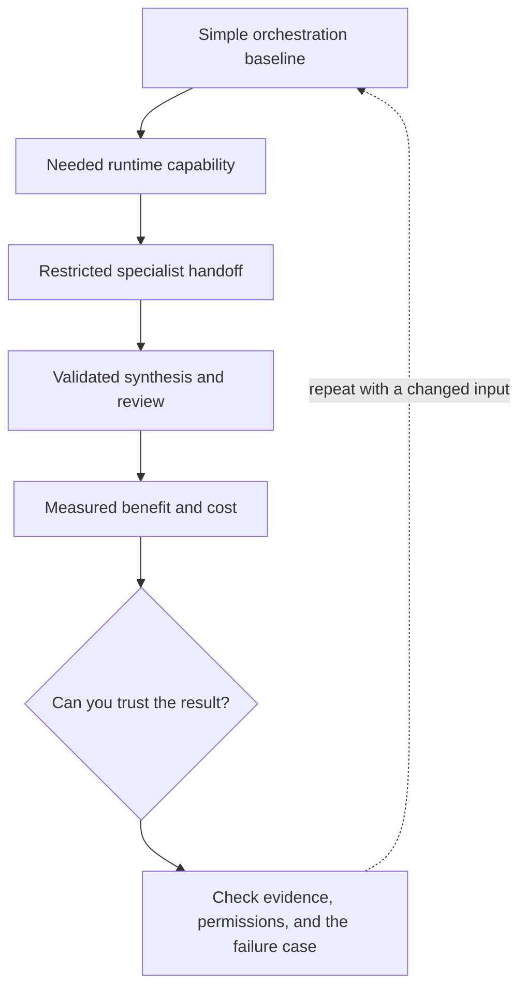

# 3. Frameworks and multiple agents: earn the complexity

**Advanced · about 2.5 hours including practice**

Compare explicit orchestration, framework runtimes, and specialized agents using task evidence.

Read idea → example → trace → failure. Then attempt practice/repair.md and practice/transfer.md. Answers are separate in answers/. The app also provides prediction, quiz, recall, and optional AI review.

- [Composable agent patterns](https://www.anthropic.com/research/building-effective-agents)
- [Evaluation practices](https://developers.openai.com/api/docs/guides/evaluation-best-practices)
