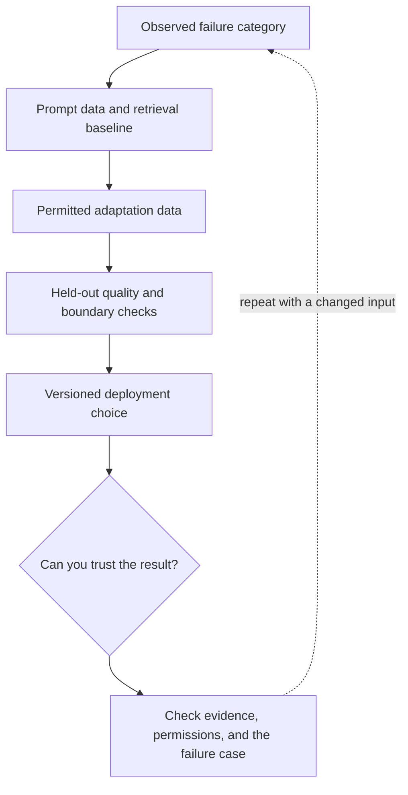

# 4. RAG, fine-tuning, LoRA, and distillation

**Advanced · about 2.5 hours including practice**

Choose an adaptation method from the failure type without turning the course into model training.

Read idea → example → trace → failure. Then attempt practice/repair.md and practice/transfer.md.

Answers are separate in answers/. The app also provides prediction, quiz, recall, and optional AI review.

- [LoRA research](https://arxiv.org/abs/2106.09685)
- [Retrieval-Augmented Generation](https://arxiv.org/abs/2005.11401)
- [Evaluation practices](https://developers.openai.com/api/docs/guides/evaluation-best-practices)
