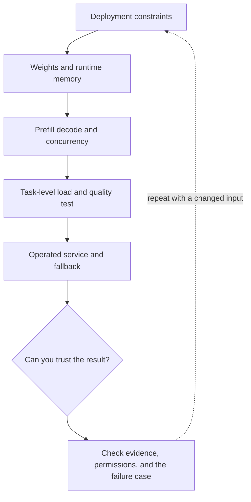

# 5. Managed APIs, self-hosting, quantization, and serving budgets

**Advanced · about 2.5 hours including practice**

Explain deployment tradeoffs and the memory/latency costs application developers need to understand.

Read idea → example → trace → failure. Then attempt practice/repair.md and practice/transfer.md. Answers are separate in answers/. The app also provides prediction, quiz, recall, and optional AI review.

- [PagedAttention / vLLM research](https://arxiv.org/abs/2309.06180)
- [Evaluation practices](https://developers.openai.com/api/docs/guides/evaluation-best-practices)
