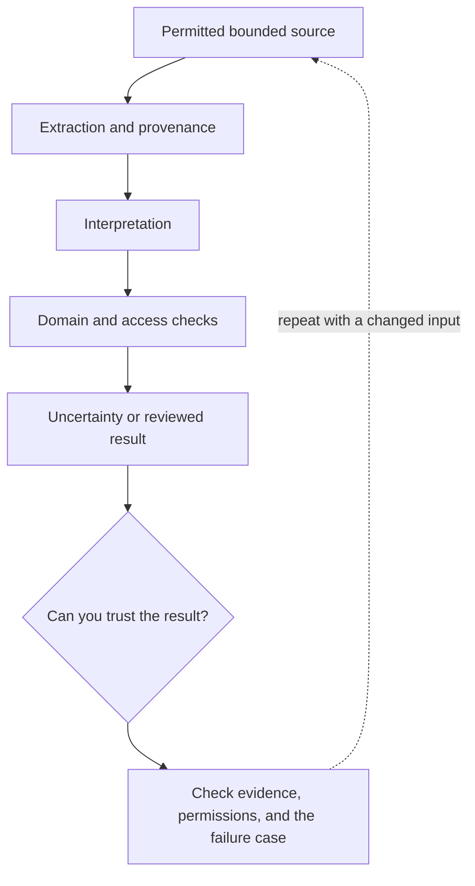

# 6. Multimodal integration: documents, images, and audio

**Advanced · about 2.5 hours including practice**

Extend the same evidence and validation boundaries to non-text inputs.

Read idea → example → trace → failure. Then attempt practice/repair.md and practice/transfer.md. Answers are separate in answers/. The app also provides prediction, quiz, recall, and optional AI review.

- [Structured outputs](https://developers.openai.com/api/docs/guides/structured-outputs)
- [OWASP prompt injection guidance](https://cheatsheetseries.owasp.org/cheatsheets/LLM_Prompt_Injection_Prevention_Cheat_Sheet.html)
