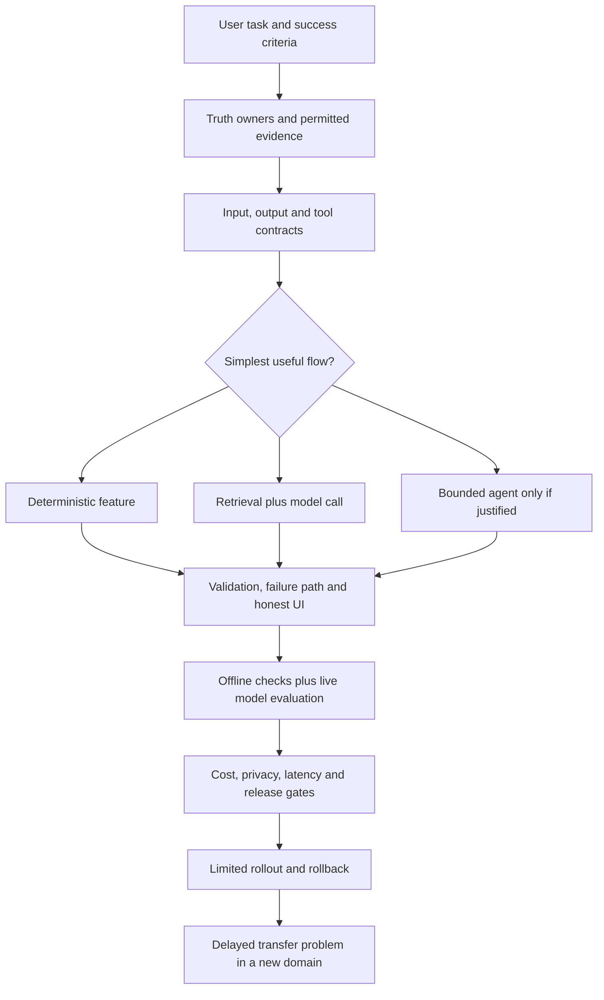

# Final capstone: design, build, break, and explain

Demonstrate an AI-powered application boundary on an unfamiliar case with observable evidence.

Start with idea.md, then example.md, trace.md and failure.md. Try practice before answers.

Remember: **Build one path. Break its boundaries. Explain what the evidence actually proves.**