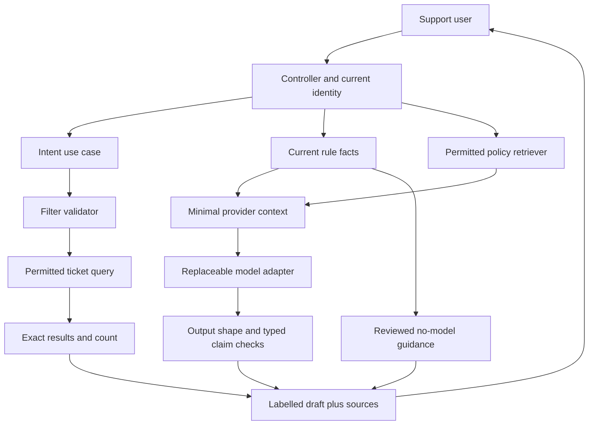

## One complete reference design

This is a design reference. The Dispatch Desk lab runs the same narrow boundaries in a different domain.

This answer does not claim a deployed support application.

### 1. Define the task and its truth owners

Finding tickets needs a proposed filter, not generated SQL. Explaining a delay needs current reviewed reasons.

Comparing selected tickets needs code to align the same fields. Answering a policy question needs permitted document versions.

Treat these as four small use cases.

Keep organization, actor, permission checks, counts, dates, reason codes and links in code. The model can map language to an allowlisted intent or draft a short explanation.

No write tool is exposed. A manual filter and reviewed reason card remain useful when generation fails.

### 2. Give each file a small job

- `controllers/assistant_controller.rb`: authenticate, bound input size, call one use case, return an owned run ID. It never builds provider prompts from whole database rows.
- `policies/ticket_scope.rb`: derive current scope from identity. Never accept model-supplied organization IDs. Recheck at tool execution and result reads.
- `services/waiting_facts.rb`: read permitted fields and compute deterministic reason codes. Return a source version and reviewed guidance.
- `services/ai/filter_contract.rb`: accept only known status/vendor fields and bounded values. Resolve ambiguous names with a clarification state.
- `services/ai/provider.rb`: own provider request format, deadlines, refusal/incomplete states and error conversion. Do not put domain rules here.
- `services/ai/result_contract.rb`: reject bad shapes, unknown source IDs and mismatched typed facts. Keep prose labelled as interpretation; membership alone does not prove its meaning.
- `models/ai_run.rb` and `jobs/explain_ticket_job.rb`: persist owner, input/source version, state and timestamps. Recheck access when work starts. Add a durable queue and recovery lease before production.
- `services/policy_retriever.rb`: return permitted current source IDs, excerpts and versions. Keep live counts in SQL. Do not retrieve across all organizations and filter only after generation.
- `mcp/read_ticket_facts_tool.rb`: expose one bounded read tool. Obtain the actor from the trusted connection/request context. Tool arguments select a ticket, not an identity.
- `presenters/assistant_result.rb`: distinguish verified facts, draft interpretation, missing evidence, stale result and fallback guidance.

### 3. Trace a delayed explanation

Request arrives → authenticate → check selected ticket → create queued run → return 202.

Worker claims it → rechecks actor and ticket → builds versioned facts → calls adapter under a deadline → validates result → saves completed/fallback/unavailable. The UI polls an owned run.

The read path rechecks access and compares current source version. Changed data produces a stale state and a refresh action.

Do not hold a database lock during a remote model call. A worker crash after a claim needs a bounded lease or reconciliation process.

A completed-job guard alone does not recover abandoned work. A retry policy needs a budget and should avoid replaying effects blindly.

This release has no business write effects, which keeps recovery simpler.

### 4. Demonstrate specific failures

Use a capturing fake provider, not production logs, for context checks. Assert the fake receives only allowed fields for the permitted actor.

- Foreign ticket: unavailable before the provider is called; no foreign title in the response or captured context.
- Revoked actor with an old in-memory object: re-resolve policy; deny rather than trusting cached active state.
- Unknown filter field: reject the proposal. Do not silently drop a privilege-related field and execute a wider query.
- Invented citation or count: fallback to reviewed facts. A correct citation with unsupported prose still needs semantic evaluation.
- Provider timeout/refusal/incomplete output: explicit unavailable/fallback state. Never save a successful score or answer from partial JSON.
- Policy withdrawal: active retrieval and answer caches stop serving that source version. Define an acceptable propagation delay and test it.
- Source changed after generation: stale result on read. A stale answer should not appear current because it is cached.
- Hostile document asks to export records: treat it as evidence text; the exposed tool set and policy checks do not permit export.
- Agent keeps asking: stop after the step budget and explain the partial outcome. Also define wall-time, token and spend limits for a real planner.

The expected outcome is a testable contract, not a particular class name. Record observed failures and fixes.

### 5. Evaluate quality separately

Create synthetic questions with expected decisions and required supporting facts. Compare a deterministic baseline, then a model-assisted version on the same held-out cases.

Track unauthorized disclosure and unsupported typed facts separately from helpfulness, clarification quality, latency and cost. Break results down by failure category; an average can hide a serious access defect.

Human-review ambiguous explanations and judge disagreements. A model judge is a fallible measurement aid.

Keep its rubric and version fixed for comparisons. Do not let it declare a missing test executed.

### 6. Make a release decision

Choose pass/fail criteria before reviewing outputs.

For a small internal pilot, require no known access-boundary failures in the test set, correct typed results, acceptable unsupported-claim rates under human review, a working fallback, and latency/spend within agreed limits.

These sample criteria do not prove zero future failures. Define the actual thresholds with the task owner.

Release behind a feature flag to a small group. Monitor failures, source freshness, latency, cost and manual fallback use.

Roll back to the deterministic path when a boundary fails or budgets are exceeded. Keep prompt/model/schema/retrieval versions on traces without routinely logging sensitive payloads.

### Review your own submission

Use four dimensions, each 0–3. Predict: follow a concrete input and failure.

Change: produce a coherent boundary and valid code/design. Verify: show observed expected/actual checks, or score a proposed-only plan at most 1.

Explain: justify a tradeoff and a changed requirement. A total is provisional.

A missing authorization or truth boundary is a reason to repair the design even if other areas score well.

Return a week later. Solve a similar task for equipment maintenance or school library operations from a blank page.

Keep the structure; reconsider the facts, permissions and failure costs.