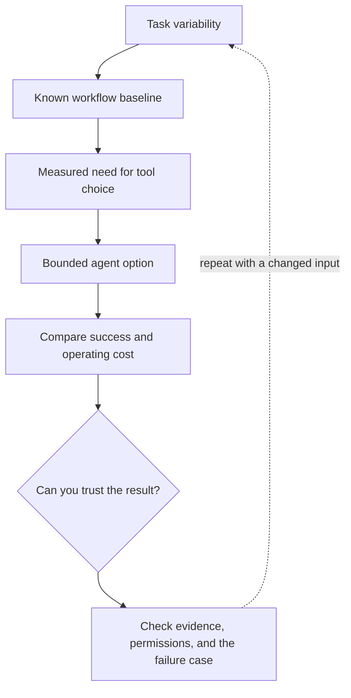

# 1. Workflow or agent: choose who controls the next step

**Beginner · about 1.5 hours including practice**

Choose fixed orchestration for known paths and model-directed steps only when they earn their cost.

Read idea → example → trace → failure. Then attempt practice/repair.md and practice/transfer.md.

Answers are separate in answers/. The app also provides prediction, quiz, recall, and optional AI review.

- [Composable agent patterns](https://www.anthropic.com/research/building-effective-agents)
- [ReAct research](https://arxiv.org/abs/2210.03629)
