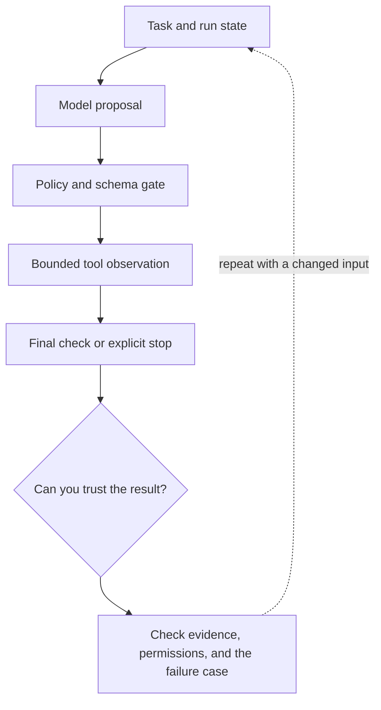

# 2. A bounded agent loop you can trace

**Intermediate · about 2 hours including practice**

Implement proposal, policy, execution, observation, and stopping as explicit states.

Read idea → example → trace → failure. Then attempt practice/repair.md and practice/transfer.md. Answers are separate in answers/. The app also provides prediction, quiz, recall, and optional AI review.

- [Composable agent patterns](https://www.anthropic.com/research/building-effective-agents)
- [ReAct research](https://arxiv.org/abs/2210.03629)
