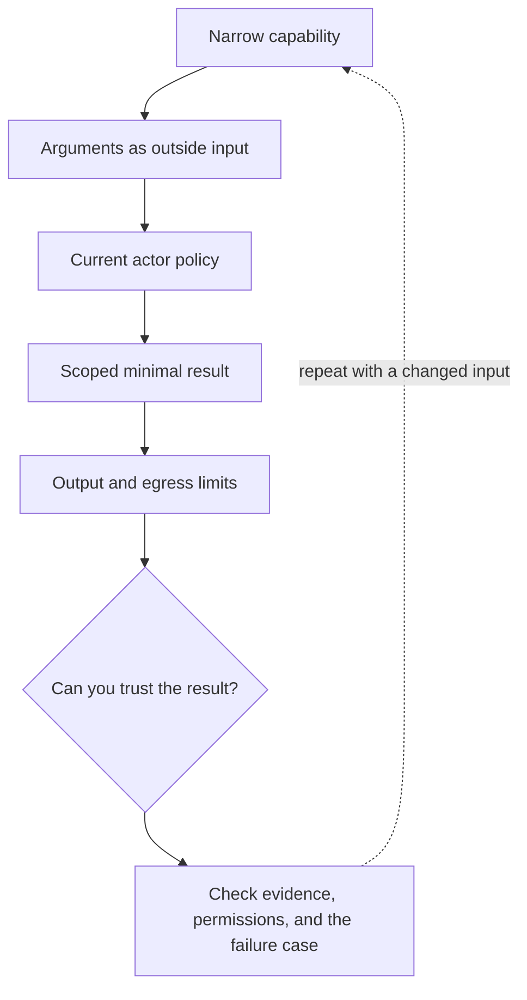

# 3. Tools are capabilities with a policy boundary

**Intermediate · about 2 hours including practice**

Design narrow tools and authorize every execution against current application state.

Read idea → example → trace → failure. Then attempt practice/repair.md and practice/transfer.md. Answers are separate in answers/. The app also provides prediction, quiz, recall, and optional AI review.

- [Function calling](https://developers.openai.com/api/docs/guides/function-calling)
- [MCP security boundaries](https://modelcontextprotocol.io/docs/2025-11-25/tutorials/security/security_best_practices)
