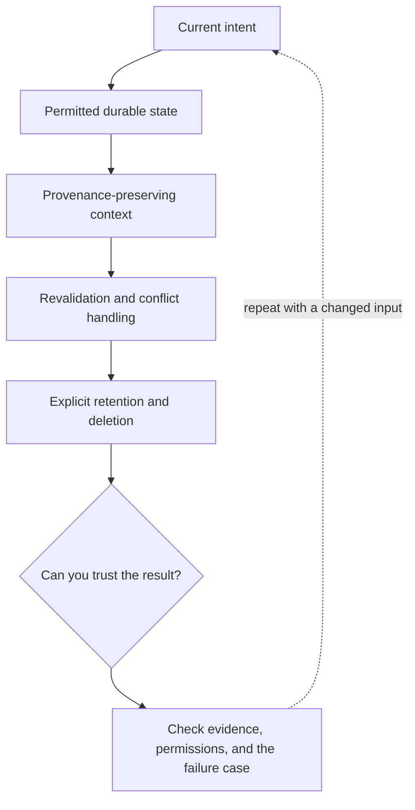

# 4. Memory is application data with a lifetime

**Intermediate · about 2 hours including practice**

Choose what to retain, revalidate, summarize, and delete between agent steps and sessions.

Read idea → example → trace → failure. Then attempt practice/repair.md and practice/transfer.md.

Answers are separate in answers/. The app also provides prediction, quiz, recall, and optional AI review.

- [Conversation state](https://developers.openai.com/api/docs/guides/conversation-state)
- [OWASP prompt injection guidance](https://cheatsheetseries.owasp.org/cheatsheets/LLM_Prompt_Injection_Prevention_Cheat_Sheet.html)
