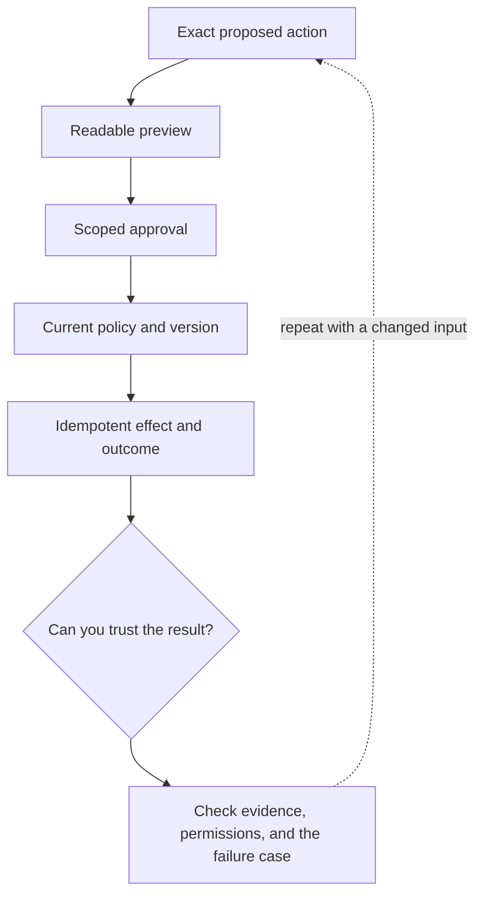

# 5. Write actions: preview, approval, and stale state

**Intermediate · about 2 hours including practice**

Bind approval to an exact operation and recheck it before an effect.

Read idea → example → trace → failure. Then attempt practice/repair.md and practice/transfer.md.

Answers are separate in answers/. The app also provides prediction, quiz, recall, and optional AI review.

- [MCP security boundaries](https://modelcontextprotocol.io/docs/2025-11-25/tutorials/security/security_best_practices)
- [Composable agent patterns](https://www.anthropic.com/research/building-effective-agents)
