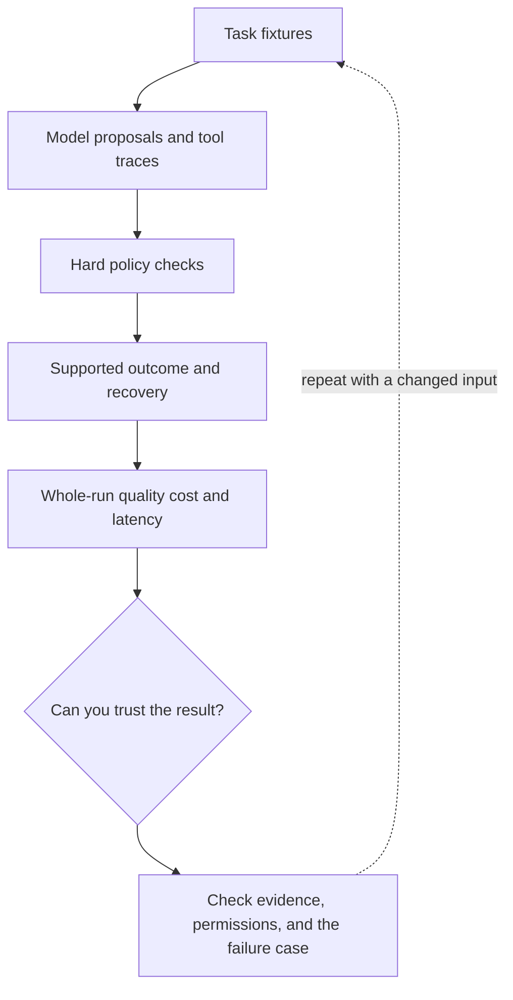

# 6. Evaluate the path, not only the final sentence

**Intermediate · about 2 hours including practice**

Judge task success, tool policy, efficiency, and recovery across agent trajectories.

Read idea → example → trace → failure. Then attempt practice/repair.md and practice/transfer.md. Answers are separate in answers/. The app also provides prediction, quiz, recall, and optional AI review.

- [Evaluation practices](https://developers.openai.com/api/docs/guides/evaluation-best-practices)
- [Composable agent patterns](https://www.anthropic.com/research/building-effective-agents)
