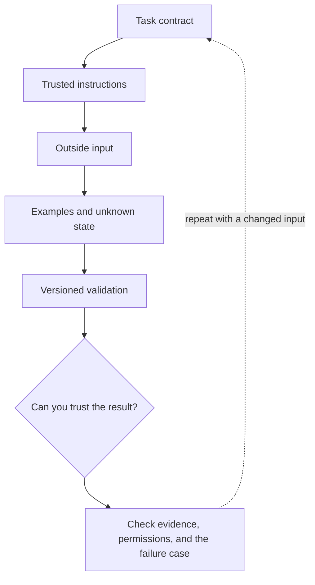

# 1. Prompts as small, testable specifications

**Beginner · about 1.5 hours including practice**

Write a clear task, trusted rules, examples, and an explicit unknown outcome.

Read idea → example → trace → failure. Then attempt practice/repair.md and practice/transfer.md.

Answers are separate in answers/. The app also provides prediction, quiz, recall, and optional AI review.

- [Function calling](https://developers.openai.com/api/docs/guides/function-calling)
- [Structured outputs](https://developers.openai.com/api/docs/guides/structured-outputs)
- [OWASP prompt injection guidance](https://cheatsheetseries.owasp.org/cheatsheets/LLM_Prompt_Injection_Prevention_Cheat_Sheet.html)
