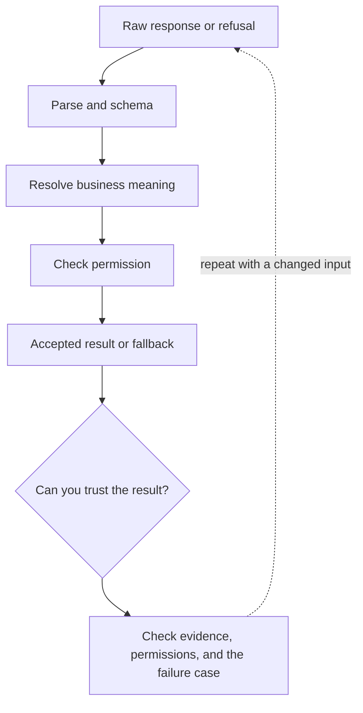

# 2. Structured output: syntax is the first gate

**Beginner · about 2 hours including practice**

Validate shape and business meaning before using a model result.

Read idea → example → trace → failure. Then attempt practice/repair.md and practice/transfer.md. Answers are separate in answers/. The app also provides prediction, quiz, recall, and optional AI review.

- [Structured outputs](https://developers.openai.com/api/docs/guides/structured-outputs)
