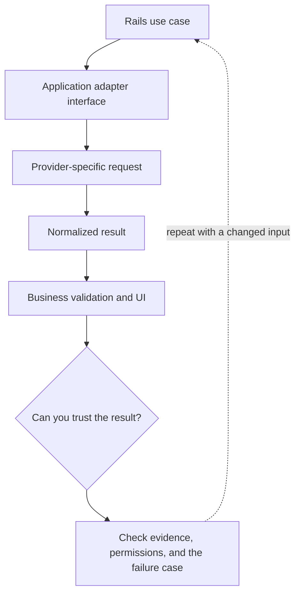

# 3. A Rails provider adapter you can replace

**Intermediate · about 2 hours including practice**

Keep provider request formats outside the business use case and normalize failures.

Read idea → example → trace → failure. Then attempt practice/repair.md and practice/transfer.md. Answers are separate in answers/. The app also provides prediction, quiz, recall, and optional AI review.

- [Structured outputs](https://developers.openai.com/api/docs/guides/structured-outputs)
- [Amazon Bedrock tool use](https://docs.aws.amazon.com/bedrock/latest/userguide/tool-use.html)
