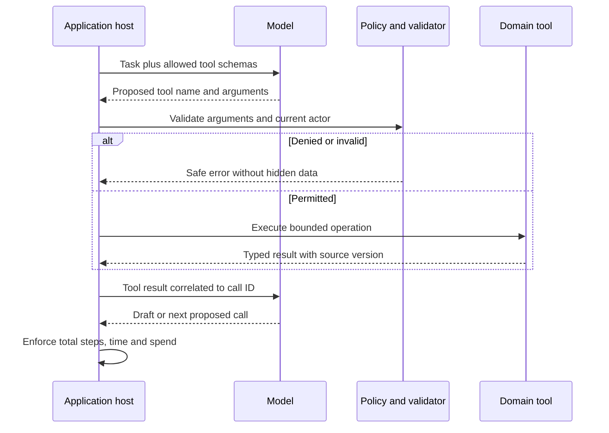

# Tool calling is a proposal–execution loop

Follow tool arguments, host execution, call IDs, and results without giving the model unrestricted access.

Start with idea.md, then example.md, trace.md and failure.md. Try practice before answers.

Remember: **The model asks. The host validates and runs.**