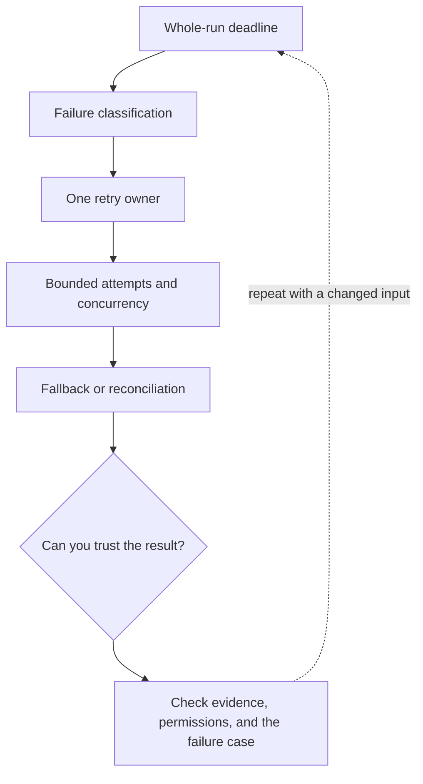

# 5. Timeouts, retries, and whole-run budgets

**Intermediate · about 2 hours including practice**

Distinguish failed requests from unknown outcomes and bound the entire integration.

Read idea → example → trace → failure. Then attempt practice/repair.md and practice/transfer.md.

Answers are separate in answers/. The app also provides prediction, quiz, recall, and optional AI review.

- [Function calling](https://developers.openai.com/api/docs/guides/function-calling)
- [Evaluation practices](https://developers.openai.com/api/docs/guides/evaluation-best-practices)
