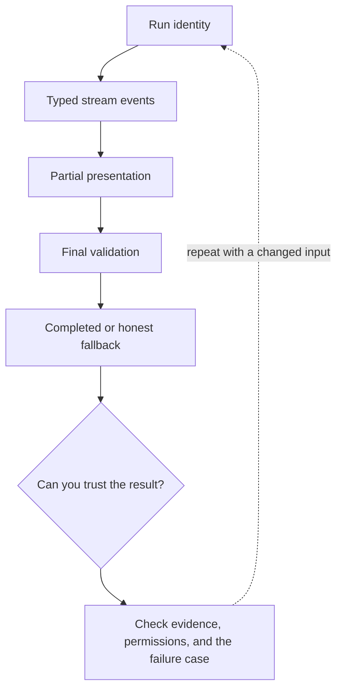

# 6. Streaming with honest UI states

**Intermediate · about 2 hours including practice**

Render partial output without treating it as a validated final answer.

Read idea → example → trace → failure. Then attempt practice/repair.md and practice/transfer.md. Answers are separate in answers/. The app also provides prediction, quiz, recall, and optional AI review.

- [Response streaming](https://developers.openai.com/api/docs/guides/streaming-responses)
