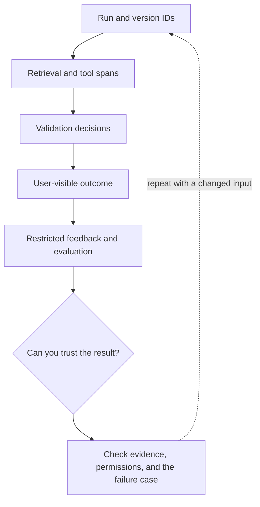

# 7. Trace the integration, not private conversations

**Intermediate · about 2 hours including practice**

Record the boundaries needed to debug quality, latency, and cost without dumping sensitive text.

Read idea → example → trace → failure. Then attempt practice/repair.md and practice/transfer.md. Answers are separate in answers/. The app also provides prediction, quiz, recall, and optional AI review.

- [Evaluation practices](https://developers.openai.com/api/docs/guides/evaluation-best-practices)
