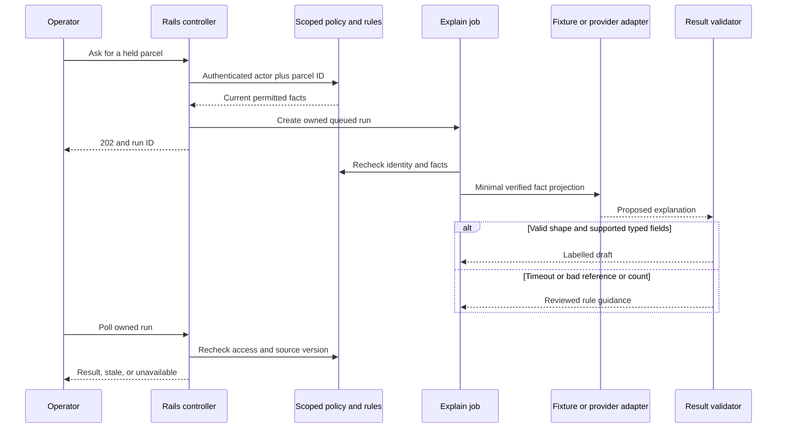

# Dispatch Desk · a complete AI boundary in Rails

A fictional warehouse team has held parcels. Operators want to filter shipments, explain a hold, compare a few records, and see a briefing. Code owns records and rules. A model may propose a filter or draft an explanation. This lab makes those boundaries visible.

**Default: no paid model calls, no API key, synthetic data only.** The fixture provider is scripted code. It demonstrates contracts and faults; it does not measure LLM accuracy. Rails, PostgreSQL/pgvector, background execution and the MCP SDK actually run.

## Start in this training folder

Requires Docker with Compose and Python 3 for the smoke script. Port 3310 must be available. Do not run these commands inside another application.

```bash
docker compose up --build -d
python3 smoke.py
```

Open http://127.0.0.1:3310. Use the operator selector. The page shows current facts and exact JSON responses. Select a fault and compare the fallback with the happy path. The app listens only on localhost. The database has no published host port.

First build downloads gems and images. If startup fails, inspect only this lab:

```bash
docker compose ps -a
docker compose logs --tail=70 setup web
```

Run checks against a **separate `_test` database**:

```bash
docker compose run --rm -e RAILS_ENV=test setup bundle exec rails db:prepare test
```

The helper refuses to run against a database without that suffix. Test setup can seed the test database; tests remain transactional. Do not point DATABASE_URL at an existing database. Training credentials in compose.yaml are local sample values.

Stop this lab while preserving data:

```bash
docker compose stop
```

Start again with `docker compose up -d`. Do not use global prune commands. `docker compose down` removes this lab’s containers/network; its named volume is retained unless you explicitly remove it.

## Follow the full flow



Read these files in order. In the learning app they are in Code lab.

1. `config/routes.rb` and `app/controllers/training/assistant_controller.rb`: task endpoints, length/shape checks, owned runs, current access on reads.
2. `app/services/training_identity.rb`: **local identity simulator**, not authentication. A user-controlled X-Learning-Actor header selects a synthetic actor. Never deploy this scheme or expose this training server publicly.
3. `app/models/shipment.rb` and `policy_document.rb`: actor/tenant scope. The model does not choose the tenant.
4. `app/services/ai/fact_builder.rb`: current truth, rule IDs, source version, reviewed next steps.
5. `app/services/ai/filter.rb`, `intent_service.rb`, and `providers/fixture_provider.rb`: allowlisted intent, query scope, exact count, rejected output and fallback.
6. `app/services/ai/explanation_service.rb`: typed checks, citation membership and count checks. It **does not prove arbitrary prose is supported**. Accepted prose is an AI draft.
7. `app/models/ai/run.rb` and `app/jobs/ai/explain_run_job.rb`: asynchronous state, fresh permission check, duplicate completed delivery. The local async queue is in-process and not durable.
8. `app/services/ai/document_retriever.rb`: scoped lexical or exact vector lookup. See README.retrieval.md. Documents are separate from live operational facts.
9. `app/services/ai/bounded_agent.rb`: an injected planner, read-only allowlisted tool, and maximum steps. No autonomous provider loop is started by the web UI.
10. `app/mcp/read_shipment_facts_tool.rb`, `app/services/ai/mcp_server.rb`, and `app/mcp/mcp_gateway.rb`: real official SDK tools/list and tools/call over Streamable HTTP.
11. `app/services/ai/providers/open_ai_provider.rb`: optional SDK boundary, isolated from domain logic. The default routes do not choose it automatically.
12. `test/` and `smoke.py`: prove narrow claims. Read a failure before its fix.
13. `evaluation/README.md`: score a saved synthetic decision set and see why a good average can still fail a release gate. No Docker or provider is needed for that workbook.

## Try the fault matrix

Predict before selecting a fault. Use the UI or smoke script. A proposed filter never becomes SQL text.

- `none`: scripted valid proposal. Counts are computed by scoped Active Record queries.
- `unknown_field`: model attempts an unsupported filter field. Intent is rejected; the manual filter path stays available.
- `timeout`: provider boundary fails. The service returns reviewed guidance or a manual path rather than a made-up answer.
- `malformed`: unexpected response shape. Do not parse an answer from prose with a loose regex.
- `unknown_citation`: a referenced fact was never supplied. Explanation falls back.
- `wrong_count`: typed count disagrees with verified facts. Explanation falls back.

For comparison, POST `/training/compare` with JSON `{"shipment_ids":[1,2]}`. IDs in a fresh seeded lab are normally 1 and 2, but first read `/training/shipments` to discover them. All selected records must be allowed. `/training/briefing` groups current scoped rows in code; this path intentionally works without a model.

All training JSON endpoints require the synthetic identity header. Missing or inactive actors are rejected. A run belongs to its requesting actor. A changed source version is reported stale on read. A hidden or foreign record is unavailable; do not reveal its title to explain the denial.

## Real MCP protocol, local training identity

`smoke.py` initializes protocol version 2025-11-25, sends the initialized notification, lists tools, and calls the discovered ReadShipmentFactsTool using the official Ruby SDK transport. It supplies JSON/SSE Accept headers and the protocol-version header. The tool receives the trusted actor through server_context, not through model arguments.

The SDK runs in stateless mode. The gateway builds fresh actor context per HTTP request. It checks the local Origin allowlist and synthetic identity before transport execution. This is **not a complete OAuth resource server**. A real deployment needs validated identity/token audience, issuer/scopes, TLS, host/origin controls, authorization for each object, limits and operational review. Never pass a provider or upstream token through to an arbitrary server. Read the MCP authorization chapter before adapting it.

## Optional real provider boundary

`Ai::Providers::OpenAiProvider` uses the official Ruby SDK and the Responses API. `test/jobs_and_adapter_test.rb` injects a fake client to inspect the request. To experiment separately, inject a real client with an approved server-side key and a model configured in AI_MODEL. Choose a current model that supports the requested schema and test refusals, incomplete output, timeout and provider errors. The local UI does not enable paid calls through a checkbox.

Do not send private data. Set cost/time limits first. Add a fixed synthetic evaluation set; record model, prompt/schema, cases, failures, latency and actual billing usage. A successful fixture test is not a model-quality result. `store: false` alone is not a provider-wide data-retention guarantee.

## Make one change yourself

Add a deterministic hold reason `weight_missing`. Update the schema, seed, fact builder, source version and tests. Predict how a cached explanation becomes stale. Add one unknown-reason test and one correct fallback test. Only then change the provider schema if needed.

The reference lab is not an answer to every practice task. Keep your exercise solution in a copied training folder and compare after submitting an attempt.

## Deliberate limits · what a production design must add

The local async adapter can lose queued work on restart. A run left running after a crash has no lease-recovery worker here. The lab prevents a duplicate **completed** job from running again; it does not implement universal exactly-once work. Use a durable queue, bounded leases/reconciliation, request idempotency and effect tracking before extending the design.

The UI is a small API explorer, not a production frontend. The schema is deliberately small. Retrieval uses hand-made three-dimensional vectors; no embedding provider or retrieval-quality claim is implied. No write tool executes. No autonomous multi-agent system, real OAuth flow, cloud deployment, or live-model evaluation is certified by these checks.

For an older Rails application, keep its current identity/policy/rule code. Put a small modern adapter behind an internal versioned HTTP contract if modern SDKs cannot run there. Apply the same tenant scope and validation on both sides. Do not copy this Gemfile into a legacy app.
