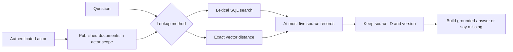

# Retrieval lab · SQL facts and document evidence

Use the same Dispatch Desk Docker project and separate test database. Follow README.md for startup and checks. This view selects only retrieval-related files, so you can focus on one path.



`db/migrate/20261027000100_create_ai_learning.rb` enables pgvector and stores vector(3). `db/seeds.rb` provides deliberately hand-made vectors. They show ordering, not the meaning quality of a learned embedding model. `DocumentRetriever` scopes candidates to the current active actor and published records before returning evidence. Lexical search binds the text query. The vector path validates dimensions, finite numeric values and nonzero input, then quotes a numeric vector literal. Never interpolate model SQL.

This small lab uses SQL vector operators directly. Rails may report an unknown vector OID and treat that column as a string; the retriever selects only the explicit source fields it needs. A larger Rails project can add a compatible pgvector type adapter.

The query uses cosine distance `<=>` and exact search. No approximate index is created. For a larger corpus, evaluate HNSW/IVFFlat using the pgvector documentation and your own filtered workload. A fast approximate search can miss valid candidates under restrictive filters. Extra scan effort can improve recall; it does not authorize a foreign tenant.

## Ingestion you would add

This lab seeds documents rather than importing real PDFs. A production ingestion job should verify source access, extract text, normalize it, split at useful boundaries, preserve headings/source versions, compute embeddings, and publish a complete version atomically. Retries should not duplicate active chunks. Revocation/deletion must remove stale evidence, embeddings and answer-cache entries. The ingestion and hybrid-ranking chapters provide the design exercises; this local retriever does not implement a full production pipeline.

## Run and inspect

```bash
docker compose run --rm -e RAILS_ENV=test setup bundle exec rails test test/retrieval_test.rb
```

The test includes a foreign-tenant vector that looks closer, an unpublished document, lexical lookup, invalid dimensions, nonnumeric/zero vectors, and source-version preservation. Read the expected permitted IDs, then change the fake query vector and predict the order.

For an interactive HTTP lexical query, use `/training/documents?query=label` with X-Learning-Actor: operator-a. The vector method is exercised in the Ruby tests; this small web route does not accept an arbitrary raw vector.

Next, create a small labelled set of questions and expected supporting sources. Measure retrieval recall separately from answer correctness. Check what happens when no relevant source exists. A citation that names a retrieved source can still support the wrong claim.
