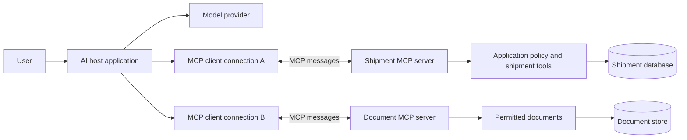

# MCP: host, client, server, and model

Draw the MCP boundary without confusing the protocol with the model or application policy.

Start with idea.md, then example.md, trace.md and failure.md. Try practice before answers.

Remember: **MCP connects capabilities. Your application still owns the decisions.**
