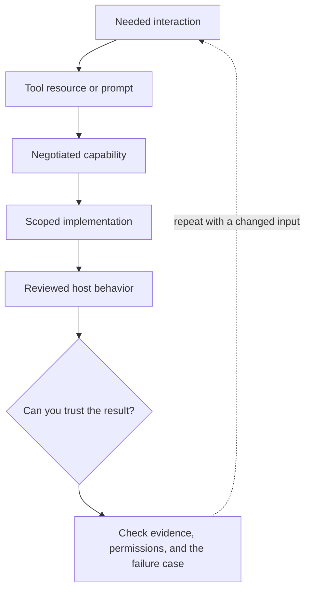

# 2. Tools, resources, prompts, and other capabilities

**Beginner · about 1.5 hours including practice**

Choose the correct MCP primitive and understand that descriptions are not enforcement.

Read idea → example → trace → failure. Then attempt practice/repair.md and practice/transfer.md. Answers are separate in answers/. The app also provides prediction, quiz, recall, and optional AI review.

- [MCP specification 2025-11-25](https://modelcontextprotocol.io/specification/2025-11-25)
- [MCP security boundaries](https://modelcontextprotocol.io/docs/2025-11-25/tutorials/security/security_best_practices)
