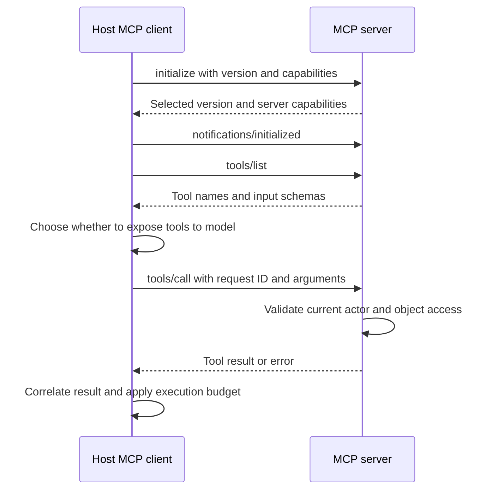

# JSON-RPC and the MCP lifecycle

Trace initialization, capabilities, request IDs, tool calls, errors, and notifications.

Start with idea.md, then example.md, trace.md and failure.md. Try practice before answers.

Remember: **Negotiate first. Correlate carefully. Classify the failure.**