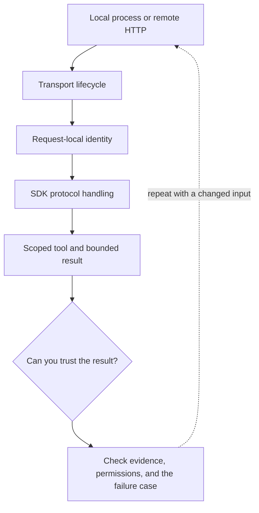

# 4. Stdio and Streamable HTTP are different deployments

**Intermediate · about 2 hours including practice**

Choose a transport and locate its process, network, identity, and streaming boundaries.

Read idea → example → trace → failure. Then attempt practice/repair.md and practice/transfer.md. Answers are separate in answers/. The app also provides prediction, quiz, recall, and optional AI review.

- [MCP transports](https://modelcontextprotocol.io/specification/2025-11-25/basic/transports)
- [MCP security boundaries](https://modelcontextprotocol.io/docs/2025-11-25/tutorials/security/security_best_practices)
