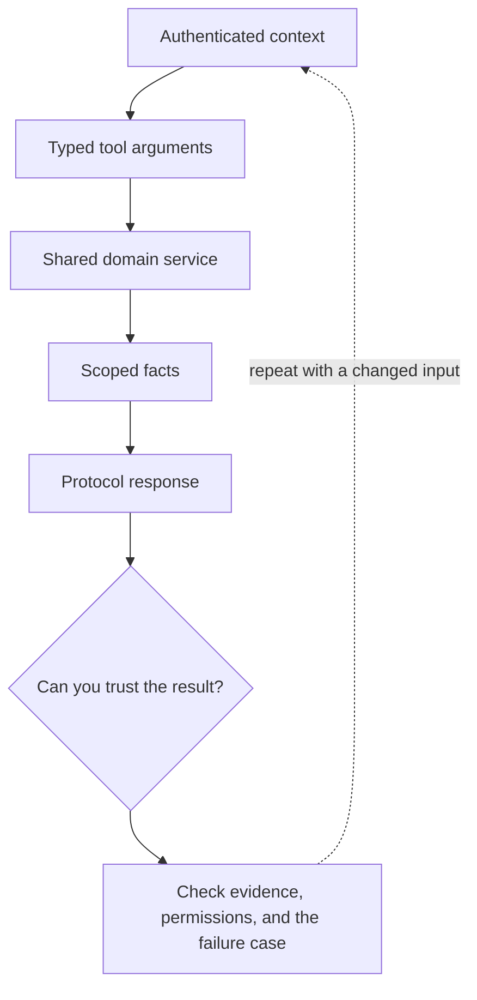

# 5. A Ruby MCP tool around a Rails use case

**Intermediate · about 2 hours including practice**

Expose a narrow Rails read without moving business policy into a model or SDK class.

Read idea → example → trace → failure. Then attempt practice/repair.md and practice/transfer.md. Answers are separate in answers/. The app also provides prediction, quiz, recall, and optional AI review.

- [Official Ruby MCP SDK](https://ruby.sdk.modelcontextprotocol.io/server/)
- [MCP security boundaries](https://modelcontextprotocol.io/docs/2025-11-25/tutorials/security/security_best_practices)
