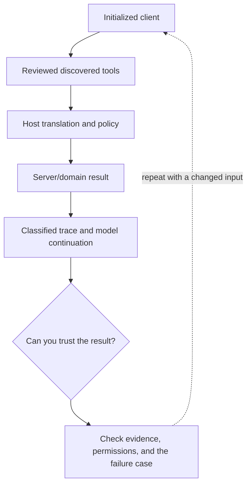

# 7. Rails as an MCP host: inspect, call, and debug

**Intermediate · about 2 hours including practice**

Connect a host to a server and distinguish transport, protocol, policy, tool, and model failures.

Read idea → example → trace → failure. Then attempt practice/repair.md and practice/transfer.md. Answers are separate in answers/. The app also provides prediction, quiz, recall, and optional AI review.

- [MCP specification 2025-11-25](https://modelcontextprotocol.io/specification/2025-11-25)
- [Official Ruby MCP SDK](https://ruby.sdk.modelcontextprotocol.io/server/)
