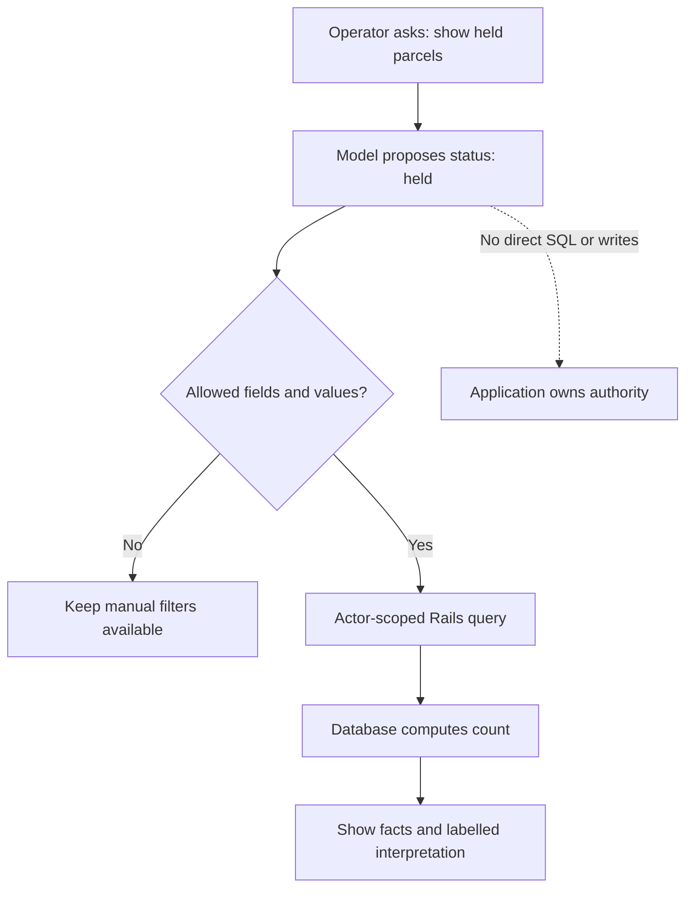

# AI is a component, not the whole application

Separate interpretation and generation from exact rules, permissions, and actions.

Start with idea.md, then example.md, trace.md and failure.md. Try practice before answers.

Remember: **Model proposes. Code checks. The application decides.**
