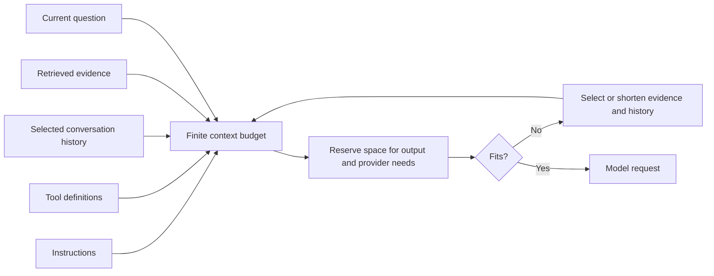

# Tokens, context, and the request budget

Explain tokens and build an input budget that leaves room for the answer.

Start with idea.md, then example.md, trace.md and failure.md. Try practice before answers.

Remember: **Count the whole suitcase, not just the question.**
