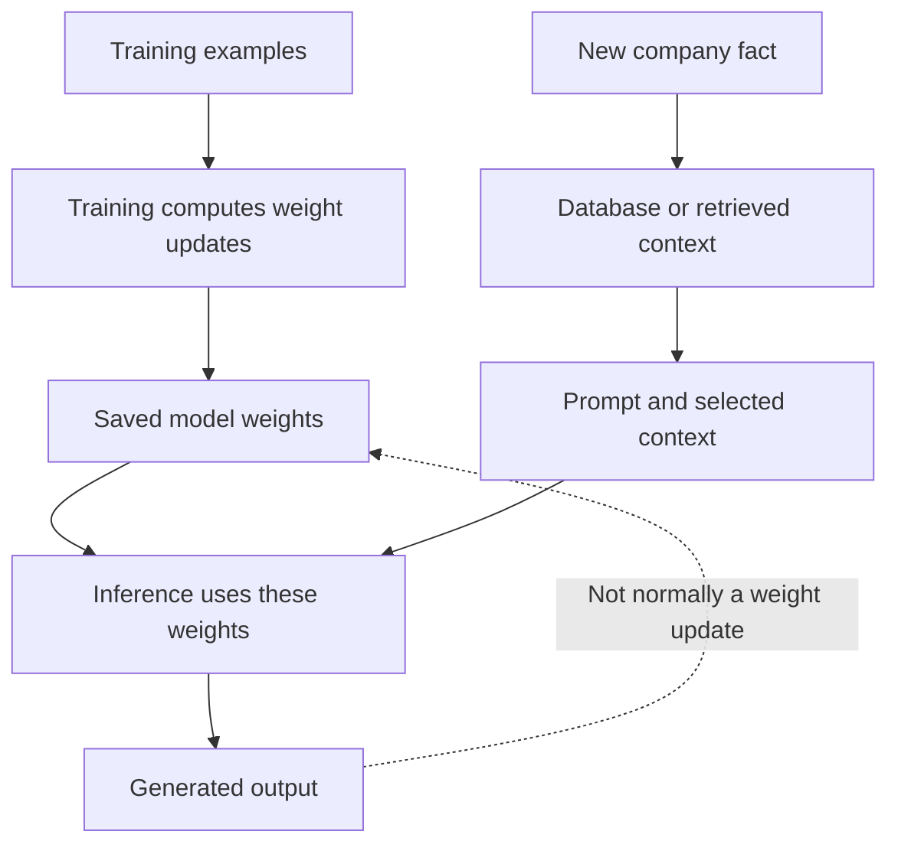

# Training, inference, and where knowledge lives

Distinguish learned weights, request context, retrieved knowledge, and application memory.

Start with idea.md, then example.md, trace.md and failure.md. Try practice before answers.

Remember: **Weights learn patterns. Context carries this task. Your system owns current facts.**
