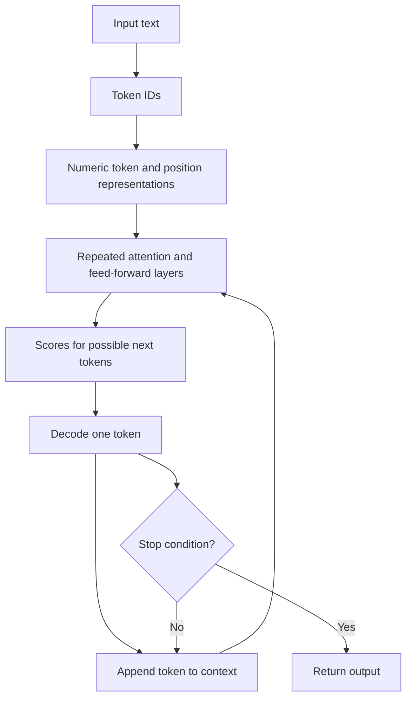

# Inside the black box: attention, prefill, and decode

Follow a text request through tokenization, contextual representations, and generated output.

Start with idea.md, then example.md, trace.md and failure.md. Try practice before answers.

Remember: **It continues a context. It does not inspect your world by itself.**