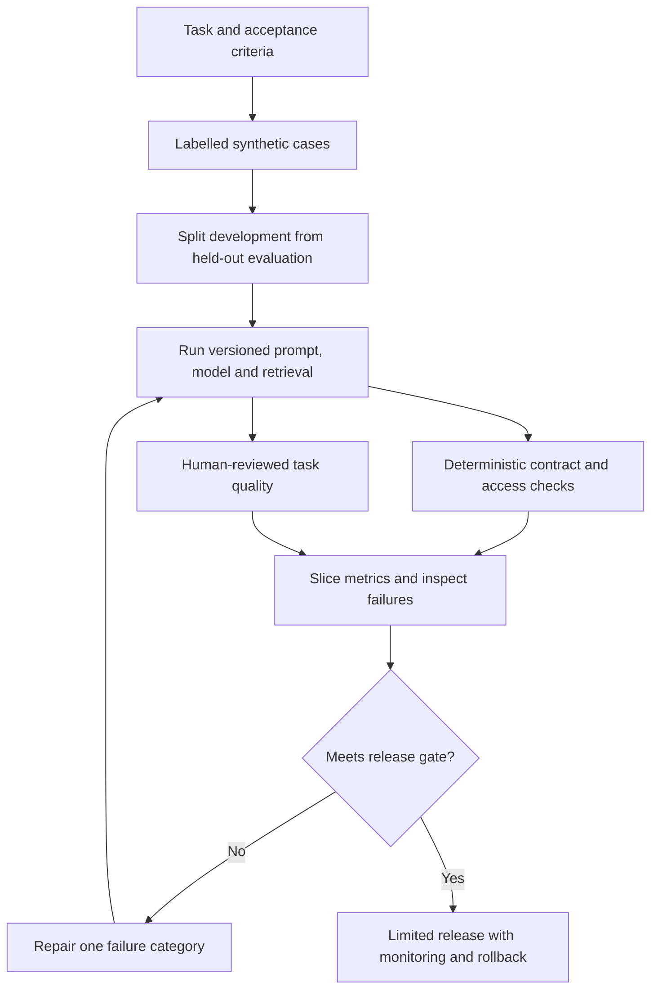

# Build an evaluation dataset before a success story

Define task outcomes, labelled cases, holdouts, and hard failure gates.

Start with idea.md, then example.md, trace.md and failure.md. Try practice before answers.

Remember: **Define success before looking at the answer.**
