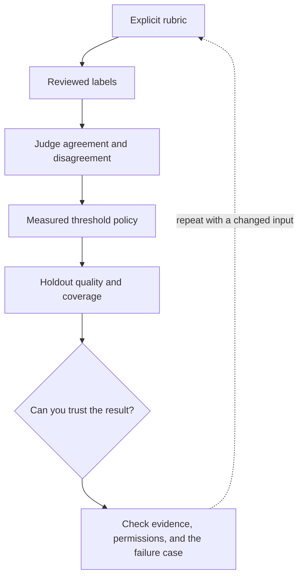

# 2. Rubrics, judges, confidence, and calibration

**Intermediate · about 2 hours including practice**

Use automated judging carefully and choose decision thresholds from observed errors.

Read idea → example → trace → failure. Then attempt practice/repair.md and practice/transfer.md. Answers are separate in answers/. The app also provides prediction, quiz, recall, and optional AI review.

- [Evaluation practices](https://developers.openai.com/api/docs/guides/evaluation-best-practices)
- [Calibration of modern neural networks](https://arxiv.org/abs/1706.04599)
