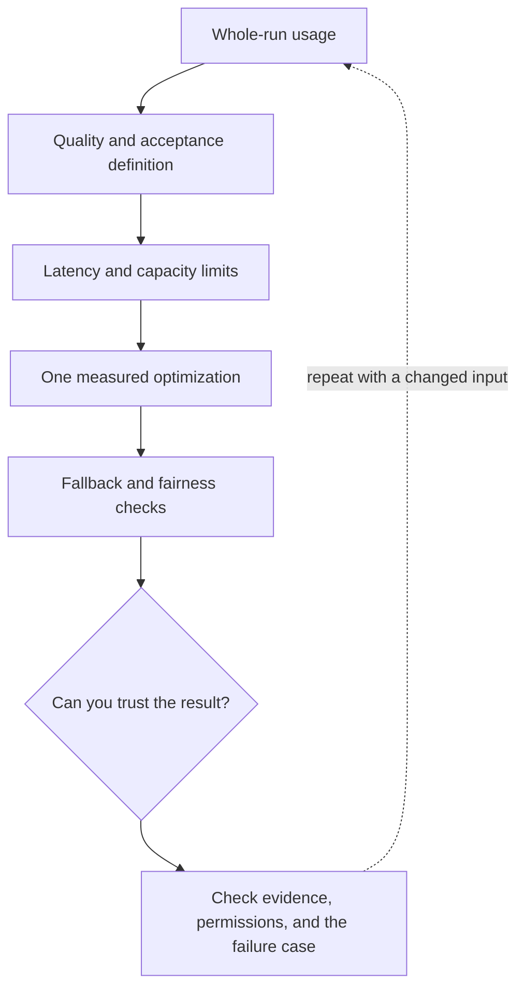

# 5. Cost, latency, capacity, and useful fallbacks

**Intermediate · about 2 hours including practice**

Budget accepted tasks rather than isolated token calls and protect shared capacity.

Read idea → example → trace → failure. Then attempt practice/repair.md and practice/transfer.md.

Answers are separate in answers/. The app also provides prediction, quiz, recall, and optional AI review.

- [Evaluation practices](https://developers.openai.com/api/docs/guides/evaluation-best-practices)
- [Prompt caching](https://developers.openai.com/api/docs/guides/prompt-caching)
