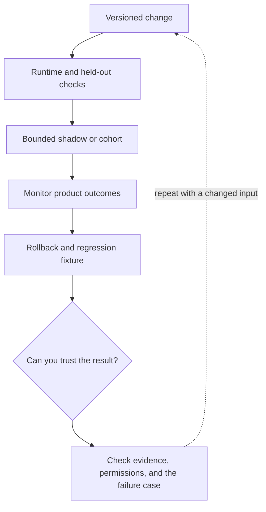

# 6. Regression gates, shadow mode, and incident response

**Intermediate · about 2 hours including practice**

Release model, prompt, tool, and index changes as versioned application changes.

Read idea → example → trace → failure. Then attempt practice/repair.md and practice/transfer.md.

Answers are separate in answers/. The app also provides prediction, quiz, recall, and optional AI review.

- [Evaluation practices](https://developers.openai.com/api/docs/guides/evaluation-best-practices)
- [Composable agent patterns](https://www.anthropic.com/research/building-effective-agents)
