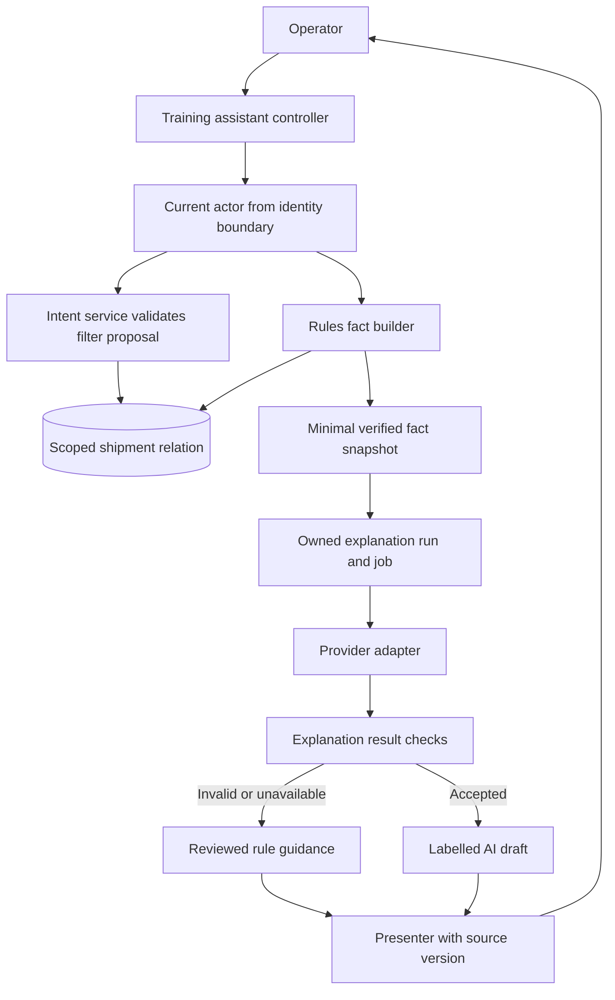

# Dispatch Desk: the whole Rails architecture

Map a useful AI feature onto ordinary Rails boundaries and separate its four user tasks.

Start with idea.md, then example.md, trace.md and failure.md. Try practice before answers.

Remember: **A useful AI feature still looks like a well-structured application.**