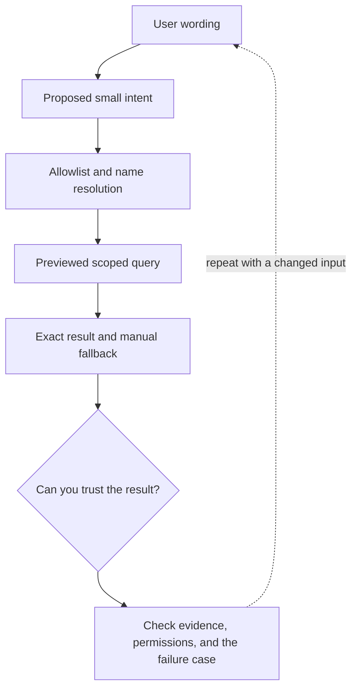

# 2. From user language to an allowlisted Rails query

**Intermediate · about 2.5 hours including practice**

Turn a proposed intent into previewed filters without executing generated SQL.

Read idea → example → trace → failure. Then attempt practice/repair.md and practice/transfer.md. Answers are separate in answers/. The app also provides prediction, quiz, recall, and optional AI review.

- [Structured outputs](https://developers.openai.com/api/docs/guides/structured-outputs)
- [Function calling](https://developers.openai.com/api/docs/guides/function-calling)
