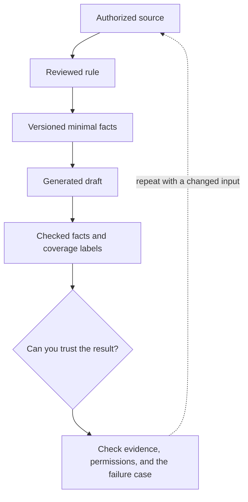

# 3. Build a fact bundle before explaining a cause

**Intermediate · about 2.5 hours including practice**

Create a minimal versioned fact set and keep verified rules separate from generated interpretation.

Read idea → example → trace → failure. Then attempt practice/repair.md and practice/transfer.md. Answers are separate in answers/. The app also provides prediction, quiz, recall, and optional AI review.

- [Evaluation practices](https://developers.openai.com/api/docs/guides/evaluation-best-practices)
- [Structured outputs](https://developers.openai.com/api/docs/guides/structured-outputs)
