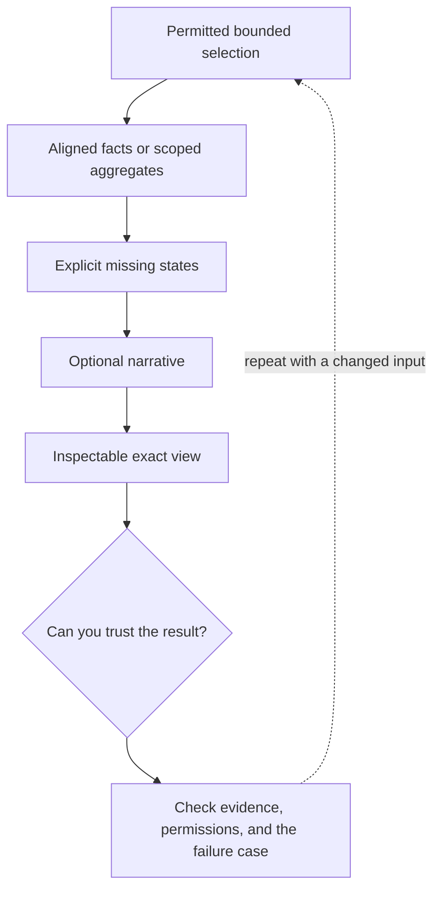

# 4. Comparisons and briefings: code aligns, AI explains

**Intermediate · about 2.5 hours including practice**

Build exact comparison and grouping inputs before asking for a useful narrative.

Read idea → example → trace → failure. Then attempt practice/repair.md and practice/transfer.md.

Answers are separate in answers/. The app also provides prediction, quiz, recall, and optional AI review.

- [Structured outputs](https://developers.openai.com/api/docs/guides/structured-outputs)
- [Evaluation practices](https://developers.openai.com/api/docs/guides/evaluation-best-practices)
