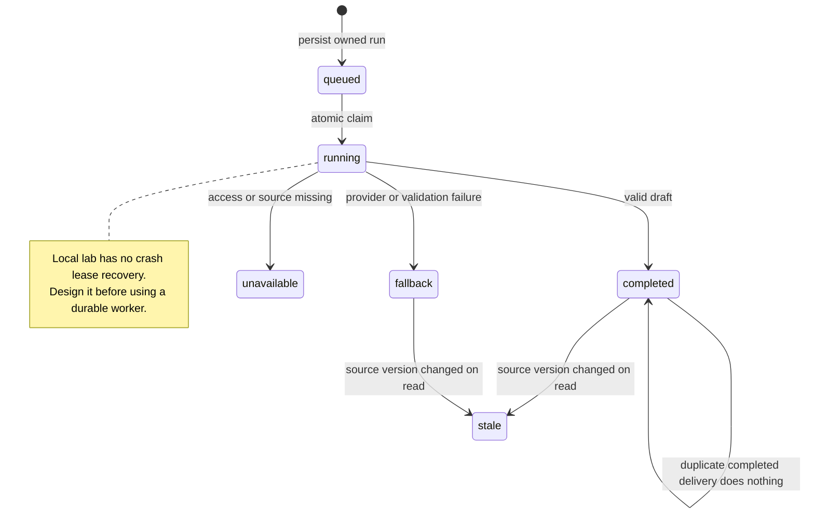

# Rails jobs, run state, and result ownership

Build a durable result contract and prevent cross-user or stale background answers.

Start with idea.md, then example.md, trace.md and failure.md. Try practice before answers.

Remember: **A run has an owner, a snapshot, and an honest state.**