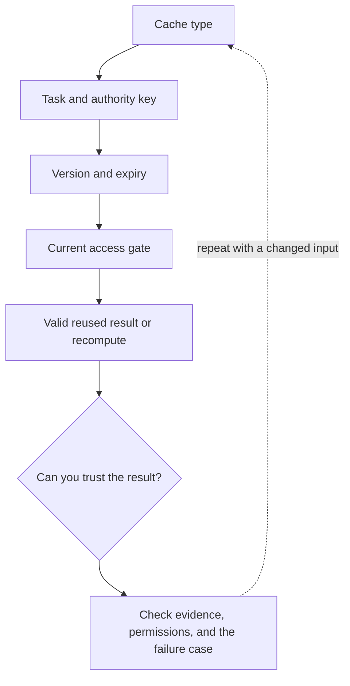

# 6. Cache answers without caching the wrong authority

**Intermediate · about 2.5 hours including practice**

Separate prompt caching, retrieval caching, and answer caching with correct invalidation.

Read idea → example → trace → failure. Then attempt practice/repair.md and practice/transfer.md. Answers are separate in answers/. The app also provides prediction, quiz, recall, and optional AI review.

- [Prompt caching](https://developers.openai.com/api/docs/guides/prompt-caching)
- [MCP security boundaries](https://modelcontextprotocol.io/docs/2025-11-25/tutorials/security/security_best_practices)
