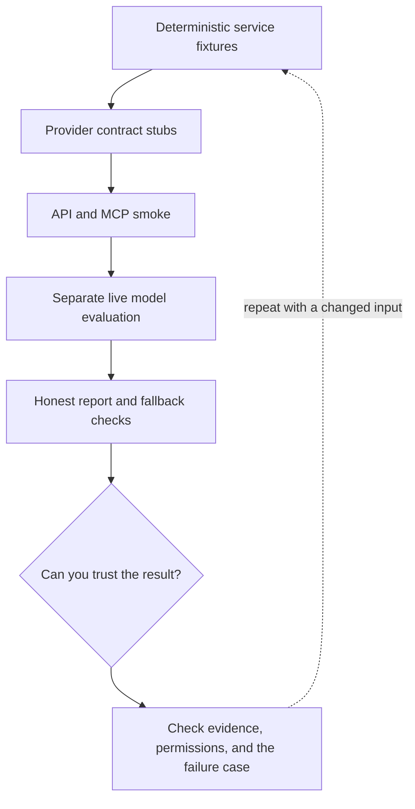

# 7. Test the Rails feature at three different layers

**Intermediate · about 2.5 hours including practice**

Separate deterministic application checks, adapter contract checks, and live model evaluations.

Read idea → example → trace → failure. Then attempt practice/repair.md and practice/transfer.md. Answers are separate in answers/. The app also provides prediction, quiz, recall, and optional AI review.

- [Evaluation practices](https://developers.openai.com/api/docs/guides/evaluation-best-practices)
- [Rails Active Job](https://guides.rubyonrails.org/v7.2/active_job_basics.html)
