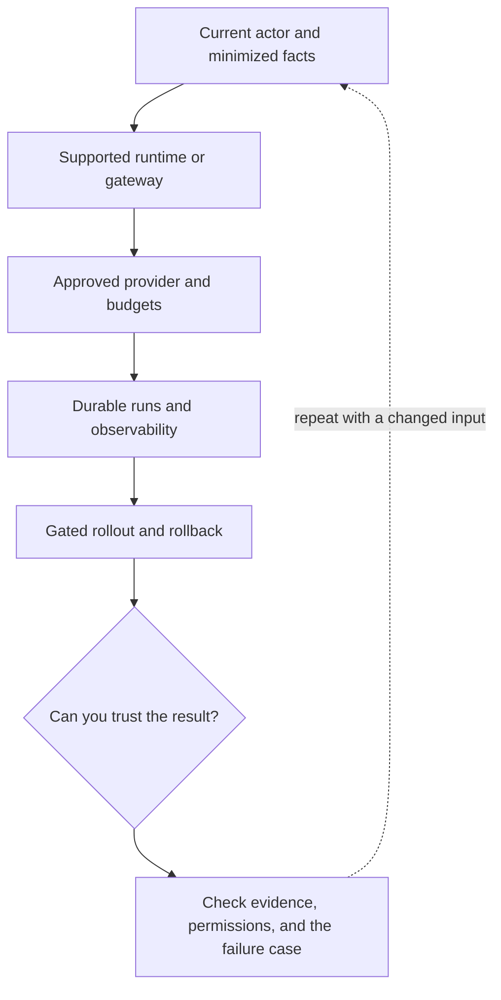

# 8. From local Rails lab to a production boundary

**Intermediate · about 2.5 hours including practice**

Plan deployment, runtime compatibility, credentials, egress, and feature rollout without copying a demo into production.

Read idea → example → trace → failure. Then attempt practice/repair.md and practice/transfer.md. Answers are separate in answers/. The app also provides prediction, quiz, recall, and optional AI review.

- [Amazon Bedrock tool use](https://docs.aws.amazon.com/bedrock/latest/userguide/tool-use.html)
- [Evaluation practices](https://developers.openai.com/api/docs/guides/evaluation-best-practices)
