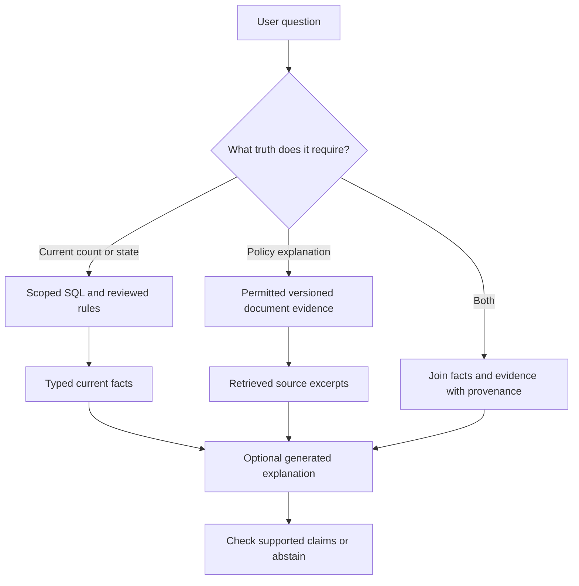

# Choose SQL facts, search, or RAG

Choose the right source before choosing a vector database.

Start with idea.md, then example.md, trace.md and failure.md. Try practice before answers.

Remember: **Find the authority first. Retrieve second. Generate only if useful.**