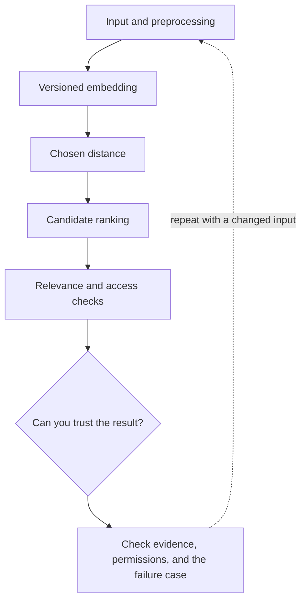

# 2. Embeddings: useful geometry, limited meaning

**Beginner · about 1.5 hours including practice**

Interpret vector similarity without treating it as truth, identity, or permission.

Read idea → example → trace → failure. Then attempt practice/repair.md and practice/transfer.md.

Answers are separate in answers/. The app also provides prediction, quiz, recall, and optional AI review.

- [Retrieval-Augmented Generation](https://arxiv.org/abs/2005.11401)
- [pgvector reference](https://github.com/pgvector/pgvector)
