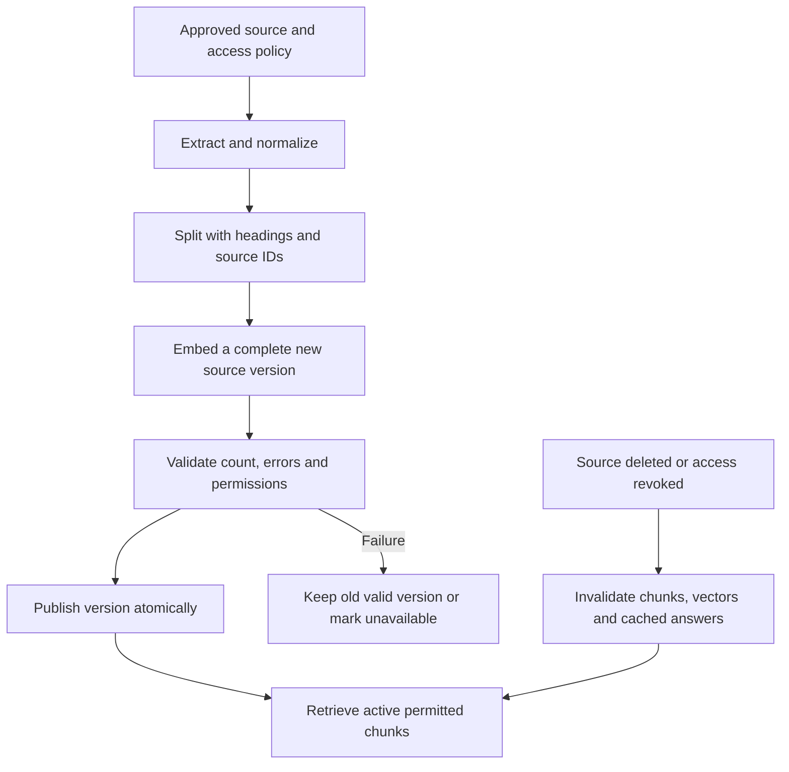

# Ingestion is a versioned data pipeline

Parse documents with provenance, access metadata, and a recoverable publication step.

Start with idea.md, then example.md, trace.md and failure.md. Try practice before answers.

Remember: **Bad extraction becomes bad evidence. Inspect upstream first.**
