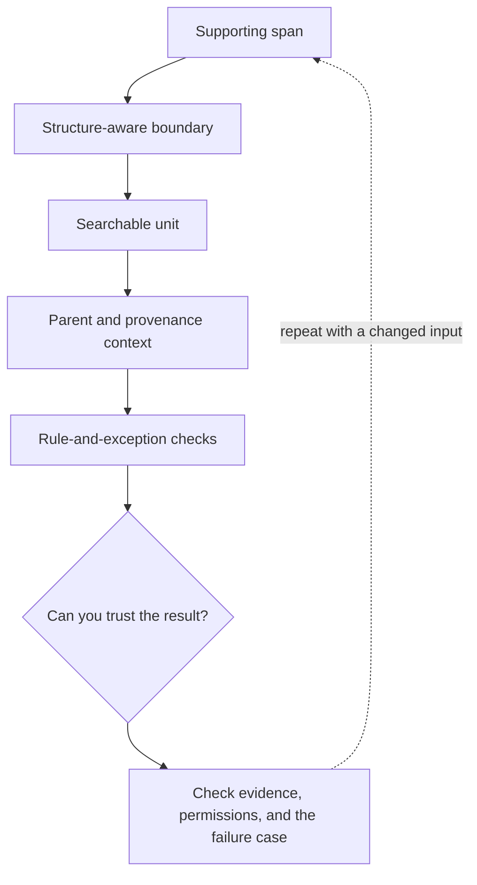

# 4. Chunk for an answerable unit

**Intermediate · about 2 hours including practice**

Choose chunk boundaries from document structure and test the tradeoff.

Read idea → example → trace → failure. Then attempt practice/repair.md and practice/transfer.md. Answers are separate in answers/. The app also provides prediction, quiz, recall, and optional AI review.

- [Retrieval-Augmented Generation](https://arxiv.org/abs/2005.11401)
- [Lost in the Middle](https://arxiv.org/abs/2307.03172)
